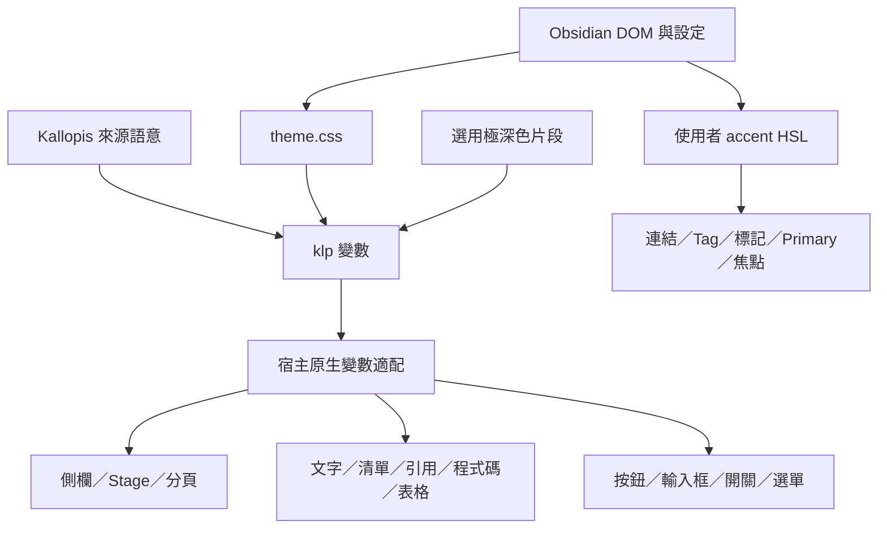

# MicroStereo 架構

本專案是 Obsidian 純 CSS 主題，沒有 JavaScript 執行碼、外掛生命週期或網路請求；宿主擁有 DOM、設定、Markdown 解析、輸入、游標及複製操作。

## 檔案責任

| 檔案 | 責任 |
| --- | --- |
| theme.css | Kallopis token 投影、原生變數適配、元件配方、閱讀與編輯樣式、內嵌 WOFF2 字型 |
| manifest.json | 主題名稱 MicroStereo、版本、作者及最低宿主版本 |
| extras/MicroStereo-ultra-dark.css | 使用者自行啟用的極深色語意覆寫 |
| licenses/ | 內嵌字型原始 OFL 授權 |
| README.md | 安裝、設定、支援範圍及授權 |
| .editorconfig | UTF-8、LF、Tab 縮排及 2 欄寬 |

## 套用流程

## 表面、控制與字型

`--klp-*` 保留來源語意與局部幾何，再映射至 Obsidian 原生變數。明暗模式各自擁有表面、文字及陰影，極深色片段只覆寫深色語意。Noto Sans TC 與 IBM Plex Mono 內嵌於 CSS 尾端，不依賴外部載入。

工作區使用 8px 外距／間距、微立體側欄與 Stage、獨立分頁 Panel。Rail 以虛線與左欄視覺整合；實際面板位置由原生拖曳管理。Windows 視窗控制區依右欄狀態保留空間。

一般按鈕保留微立體，設定按鈕採薄陰影，下拉與相鄰按鈕同為 32px。主要按鈕與行內輔色讀取宿主 accent HSL。輸入框 36px，聚焦只高亮輔色外緣。Tag 採半透明平面背景、4px 圓角、上下 2px padding 與完整行盒。

開關色塊為正方形，一般 15px、設定 18px；軌道內框至上下及所在端點均為 2px。內容盒與實際 padding 計算平移，啟用／按壓不放大。保留紅叉、綠勾、固定底色及原生事件。滑桿拖動點為 12px、3px 圓角方形。

右鍵與可自訂原生下拉採平面、1px 實線、7px 圓角與框內小斜線。下拉勾號及複製控制沿用宿主 Lucide 圖形；斜線建議選單移除陰影，Tooltip 與側欄同色且使用虛線外框。

## 閱讀與編輯

兩種模式共用文字語意、清單標記、引用及程式碼配方；不替換兩個原生語法引擎。普通識別字與標點針對可辨識 token 對齊配色，複製控制共用 24px 控制與 16px 圖形，保留原生操作。

來源空白行及圍欄保留自然行高，避免行號重疊。一般 Tab 指引線為 2px，位於真實 Tab 起點；清單指引線仍對準標記中心。作用中引用保留原始符號並移除裝飾線，非作用行保留粗圓端左線。

唯一 `!important` 規則限定即時預覽直接 `.cm-callout` 容器的 `contain: none`，解除宿主 paint containment 對陰影的裁切。主題不接管高度快取或解析器，不保證任意語法及縮放逐像素相同。

表格移除外框、保留內部格線與圓角，原生新增列／欄改為半透明粗條。原生文字選取選單、Markdown 空白折疊及游標演算法不由主題接管。

## 發行邊界

公開倉庫僅包含主題原始檔、使用說明與授權。本機測試筆記、歷史截圖、視窗量測及工具由 gitignore 排除。安裝 ZIP 僅寫入 `.obsidian/themes/MicroStereo/`，不包含或覆寫筆記庫設定。
