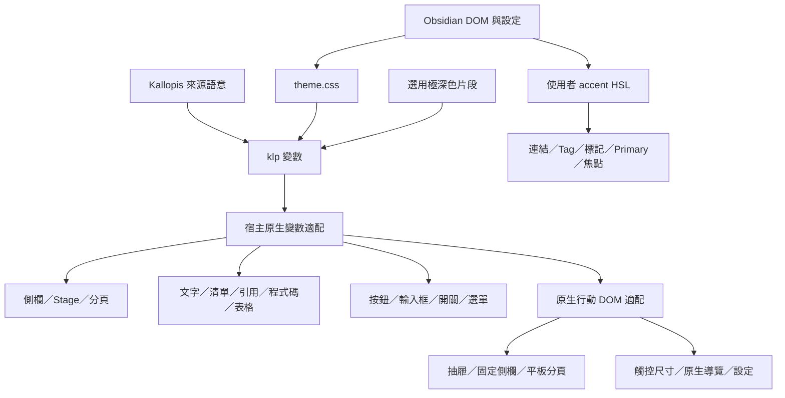

# MicroStereo 架構

本專案是 Obsidian 純 CSS 主題，沒有 JavaScript 執行碼、外掛生命週期或網路請求；宿主擁有 DOM、設定、Markdown 解析、輸入、游標及複製操作。

## 檔案責任

| 檔案 | 責任 |
| --- | --- |
| theme.css | Kallopis token 投影、原生變數適配、元件配方、閱讀與編輯樣式、內嵌 WOFF2 字型 |
| manifest.json | 主題名稱 MicroStereo、版本、作者及最低宿主版本 |
| extras/MicroStereo-ultra-dark.css | 使用者自行啟用的極深色語意覆寫 |
| licenses/ | 內嵌字型原始 OFL 授權 |
| README.md | 安裝、設定、支援範圍及授權 |
| .editorconfig | UTF-8、LF、Tab 縮排及 2 欄寬 |

## 套用流程

## 表面、控制與字型

`--klp-*` 保留來源語意與局部幾何，再映射至 Obsidian 原生變數。明暗模式各自擁有表面、文字及陰影，極深色片段只覆寫深色語意。Noto Sans TC、Obel Mono 與 IBM Plex Mono 內嵌於 CSS 尾端，不依賴外部載入。

預設等寬字型由 `--klp-font-code` 對應 Obel Mono 1.002 的正體與斜體可變 WOFF2。兩者均內嵌於主題。Obel Mono 缺字時依原堆疊回退至 IBM Plex Mono、系統等寬字型和 Noto Sans TC。

工作區使用 8px 外距／間距、微立體側欄與 Stage、獨立分頁 Panel。Rail 以虛線與左欄視覺整合；實際面板位置由原生拖曳管理。Windows 視窗控制區依右欄狀態保留空間。

一般按鈕保留微立體，設定按鈕採薄陰影，下拉與相鄰按鈕同為 32px。主要按鈕與行內輔色讀取宿主 accent HSL。輸入框 36px，聚焦只高亮輔色外緣。Tag 採半透明平面背景、4px 圓角、上下 2px padding 與完整行盒。

開關色塊為正方形，一般 15px、設定 18px；軌道內框至上下及所在端點均為 2px。內容盒與實際 padding 計算平移，啟用／按壓不放大。保留紅叉、綠勾、固定底色及原生事件。滑桿拖動點為 12px、3px 圓角方形。

右鍵與可自訂原生下拉採平面、1px 實線、7px 圓角與框內小斜線。下拉勾號及複製控制沿用宿主 Lucide 圖形；斜線建議選單移除陰影，Tooltip 與側欄同色且使用虛線外框。

## 閱讀與編輯

0.1.29 字色依最新需求：無局部背景的普通內文採次要文字色，亮色#6a655b、深色#bab5aa。粗體採宿主輔色，斜體採不透明純色（亮#746f65／暗#989387）；標題保持klp-text。Callout、表格、標記、程式碼、Tag、控制項及明確inline background容器將text-normal局部重設為klp-text；其中繼承普通前景的背景表面另恢復主文字色，已有語意或inline前景的文字保留自身配方。作用範圍僅筆記閱讀／編輯容器，不影響側欄與設定介面，不改排版。隨 0.1.29 發布。

兩種模式共用文字語意、清單標記、引用及程式碼配方；不替換兩個原生語法引擎。普通識別字與標點針對可辨識 token 對齊配色，複製控制共用 24px 控制與 16px 圖形，保留原生操作。 閱讀預覽將原生語法類別直接對應同一組程式碼色票，即時預覽的原子常值也使用常值色。空白無序列點的尾端空白保留並靠行末對齊，使游標落在標記區右緣的正文起點。 Canvas 卡片的 Markdown 渲染共用閱讀色彩與背景例外，即時預覽引用內的粗斜體則明確沿用正文強調色。

來源空白行及圍欄保留自然行高，避免行號重疊。一般 Tab 指引線為 2px，位於真實 Tab 起點；清單指引線仍對準標記中心。作用中引用保留原始符號並移除裝飾線，非作用行保留粗圓端左線。

清單內的行內程式碼續行可能沒有HyperMD-list-line類別，只有子token帶cm-list層級；以cm-line:has([class*="cm-list-"])辨識這種續行，將cm-indent恢復static、偽元素left設auto並沿用indentation-guide-editing-indent。這讓多層指引線依各Tab原生位置及完整行高繪製，不誤用獨立Tab的零偏移；一般非清單Tab仍使用原有游標起點定位。此修正隨 0.1.29 發布。

唯一 `!important` 規則限定即時預覽直接 `.cm-callout` 容器的 `contain: none`，解除宿主 paint containment 對陰影的裁切。主題不接管高度快取或解析器，不保證任意語法及縮放逐像素相同。

表格移除外框、保留內部格線與圓角，原生新增列／欄改為半透明粗條。原生文字選取選單、Markdown 空白折疊及游標演算法不由主題接管。

## 行動適配

行動樣式限定 `body.is-mobile`，平板分頁及固定側欄限定 `body.is-tablet`；共用桌面語意與 `effect-frame-relief`，不另建行動色盤。原生 workspace、drawer、mobile-navbar、toolbar 分別投影同一組表面；保留安全區、鍵盤位置、滑動與原生側欄事件。Stage 外距仍為 8px，分頁容器留出陰影繪製空間。新版宿主的 mod-raised 玻璃效果改為實色微立體，設定保留薄陰影及既有圓角層級。

行動端文件根節點與工作區共用不透明的 app 底色，包含選用極深色片段。側欄或主內容平移期間，文件畫布提供一致的底色；深色模式也將根畫布標記為深色。這層底色獨立於原生側欄遮罩與動畫。

觸控控制以宿主 touch-size-m（44px）保留可點擊高度。複製控制只放大觸控盒，圖形仍為 16px；下拉右側保留箭頭空間，系統選取器不由 CSS 接管。WebKit 遮罩與背景濾鏡均有前綴適配。行號頁面的左右留白改為 48px／16px，避免窄螢幕沿用桌面雙側 64px。

0.1.30 明確在 body.is-mobile 重新投影 toggle／slider 的宿主變數，避免原生行動預設覆寫：toggle 軌道 4px、正方形色塊 2px 圓角；slider 拖動點 12×12px、3px 圓角、4px 軌道，按壓不放大。WebKit 拖動點 top 歸零，只用 (track−thumb)/2 的 margin 置中，避免原生 top 與 margin 重複偏移。側欄下拉的實際表面位於 workspace-drawer-tab-select > workspace-tab-header-inner，單獨套用 6px 控制圓角；不更換選單或事件。

驗證採隔離 QA 筆記庫的原生行動模擬 DOM，涵蓋橫向 1024、直向 768 及手機 390／412 級距、明暗、閱讀／編輯、側欄與設定。共用五類元件各七項視覺屬性在明暗模式共 70 項桌面比較相同。這些是 Chromium 模擬證據，未完成實體 iPadOS WebKit 或 Android 裝置驗收，不宣稱跨引擎像素一致。

## 發行邊界

公開倉庫僅包含主題原始檔、使用說明與授權。本機測試筆記、歷史截圖、視窗量測及工具由 gitignore 排除。安裝 ZIP 僅寫入 `.obsidian/themes/MicroStereo/`，不包含或覆寫筆記庫設定。
